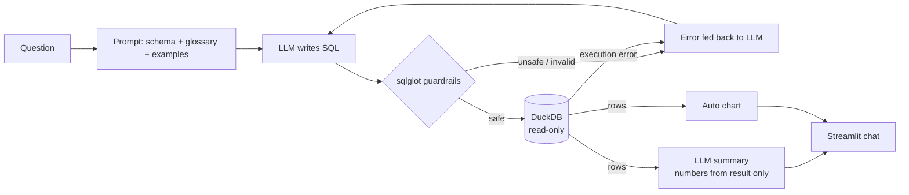

# RetailPulse AI Analyst — Text-to-SQL for E-Commerce Analytics

Ask business questions in plain English and get back **validated SQL, the result table, a chart and a short written answer** — over the star schema from my [RetailPulse](https://github.com/likhi1018/RetailPulse) project (100K+ real Olist e-commerce orders).

**Stack:** Python · LLM via OpenAI-compatible API (Gemini by default) · DuckDB · sqlglot · Streamlit · pytest

> "Which 5 states have the worst late-delivery rate?" → SQL → table + bar chart → *"Alagoas has the highest late-delivery rate at 21.4%, followed by Maranhão (17.4%)…"*

---

## Why this project

Business users wait on analysts for simple questions like "revenue by region last quarter." Text-to-SQL tools can answer instantly, but naive versions hallucinate columns, use the wrong metric definitions, or run unsafe SQL. This project focuses on the three things that make it trustworthy:

1. **Grounding** — the model gets the live schema, sample values for categorical columns, join paths, and a **business glossary** (e.g. revenue = item price on delivered orders; a customer is `customer_unique_id`, not the order-level id). These are the same definitions used in RetailPulse, so answers match the official numbers.
2. **Guardrails** — every query is parsed with `sqlglot` before it runs: one statement only, `SELECT`/CTEs only, known tables only, no file-reading functions, automatic row limit. The DuckDB connection has external access disabled and its config locked, so even a missed case can't read files or write data.
3. **Self-correction + evaluation** — if a query fails to parse or execute, the error is sent back to the model to fix (up to 3 attempts). A **25-question benchmark** with gold SQL measures execution accuracy.

## How it works



| File | Role |
|---|---|
| `app/db.py` | Loads the 9 star-schema tables from Parquet into DuckDB, then locks it down |
| `app/schema.py` + `app/glossary.yaml` | Builds the schema/business-rules context for the prompt |
| `app/guard.py` | SQL validation and row limiting |
| `app/engine.py` | Generate → validate → execute → retry → summarize |
| `app/llm.py` | Provider-agnostic client (Gemini, OpenAI, Groq, Ollama…) |
| `app/charts.py` | Picks a line or bar chart when the result suits one |
| `streamlit_app.py` | Chat UI with SQL transparency and CSV download |
| `eval/` | Benchmark questions, gold SQL and scoring |
| `tests/` | Guardrail, self-correction and comparator tests |

## Evaluation

`eval/questions.yaml` has 25 questions across aggregation, time series, rankings, joins, window functions, customer analytics, delivery and one deliberately **unanswerable** question (profit margin — the data has no product cost), which the model must decline rather than guess.

A model answer is correct when its **result set matches the gold query's result** (row order and column names ignored, numbers to 1 decimal). Several gold answers are RetailPulse's headline findings (R$13.2M revenue, 3.0% repeat rate, 32.4% of bad reviews from late orders).

```bash
python -m eval.run_eval            # scores your configured model -> eval/results.md
python -m eval.run_eval --oracle   # harness self-check with gold SQL (100%)
```

Running the benchmark writes `eval/results.md` (accuracy overall and by category, first-try rate, self-corrections) and `eval/results.csv` (per-question SQL and outcome).

## Run it

```bash
git clone https://github.com/likhi1018/retailpulse-ai-analyst.git
cd retailpulse-ai-analyst
python -m venv .venv && source .venv/bin/activate
pip install -r requirements.txt
cp .env.example .env          # add your API key
export $(grep -v '^#' .env | xargs)
streamlit run streamlit_app.py
```

A free Gemini API key from Google AI Studio is enough. To use OpenAI or another provider, change `LLM_BASE_URL` and `LLM_MODEL` in `.env`.

Run the tests: `pytest -q`

## Example questions

- What was total revenue and average order value in 2018?
- Show monthly revenue for 2017 and 2018
- Top 10 categories by revenue with their share of total
- How does average review score change with delivery delay?
- What share of customers are repeat buyers?
- Revenue by RFM segment

Follow-up questions work too ("now only for the Northeast").

## Data

The `data/` folder holds the star schema produced by RetailPulse's SQL pipeline, stored as Parquet (fact_sales, fact_orders, dim_customer, dim_product, dim_seller, dim_geography, dim_date, customer_rfm, cohort_retention).

Source: [Brazilian E-Commerce Public Dataset by Olist](https://www.kaggle.com/datasets/olistbr/brazilian-ecommerce), CC BY-NC-SA 4.0. Amounts are in Brazilian reais (R$). Code is MIT-licensed.

## Limitations and next steps

- Questions outside the schema (costs, marketing spend, inventory) are declined, not answered.
- Ambiguous questions ("best states") get the model's interpretation; the SQL is always shown so the user can check it.
- Next: retrieve only the relevant tables per question for larger schemas, and log user feedback on answers to grow the benchmark.
